<a href="https://portfolio-qodri.netlify.app/">
<picture>
  <source media="(max-width: 768px)" srcset="assets/portfolio-hero-mobile.svg">
  
</picture>
</a>

<a href="https://portfolio-qodri.netlify.app/"><b>VIEW PORTFOLIO ↗</b></a> &nbsp; · &nbsp; <a href="https://github.com/QiuuDev?tab=repositories">EXPLORE REPOSITORIES ↗</a>

<picture>
  <source media="(max-width: 768px)" srcset="assets/portfolio-section-01-mobile.svg">
  
</picture>

<picture>
  <source media="(max-width: 768px)" srcset="assets/portfolio-about-mobile.svg">
  
</picture>

About me · Bahasa Indonesia

Saya Muhammad Qodri, juga dikenal sebagai QiuuDev / BoringDev. Saya bekerja paruh waktu sebagai Front-End Developer di Talikama Creative sambil kuliah Ilmu Komputer di Universitas Bumigora. Saya membangun aplikasi web, aplikasi mobile, dan otomatisasi. PHP, Dart/Flutter, serta Python adalah fokus utama saya; teknologi lain saya gunakan sesuai kebutuhan proyek.

Prinsip saya: **Lazy by nature. Efficient by choice. Automated by design.**

<picture>
  <source media="(max-width: 768px)" srcset="assets/portfolio-section-02-mobile.svg">
  
</picture>

<picture>
  <source media="(max-width: 768px)" srcset="assets/portfolio-toolkit-mobile.svg">
  
</picture>

<picture>
  <source media="(max-width: 768px)" srcset="assets/portfolio-section-03-mobile.svg">
  
</picture>

<a href="https://lombokgenerator.xyz/">
<picture>
  <source media="(max-width: 768px)" srcset="assets/portfolio-project-generator-mobile.svg">
  
</picture>
</a>

<a href="https://lombokgenerator.xyz/">Live website ↗</a> &nbsp; · &nbsp; <a href="https://github.com/QiuuDev/generator_invoice">Public repository ↗</a>

<a href="https://primetransindo.com/">
<picture>
  <source media="(max-width: 768px)" srcset="assets/portfolio-project-prime-mobile.svg">
  
</picture>
</a>

<a href="https://github.com/QiuuDev/Qiu_Schedule">
<picture>
  <source media="(max-width: 768px)" srcset="assets/portfolio-project-schedule-mobile.svg">
  
</picture>
</a>

<a href="https://github.com/QiuuDev/stride-running-coach">
<picture>
  <source media="(max-width: 768px)" srcset="assets/portfolio-project-stride-mobile.svg">
  
</picture>
</a>

<a href="https://github.com/QiuuDev/cyberbullying-detector">
<picture>
  <source media="(max-width: 768px)" srcset="assets/portfolio-project-python-mobile.svg">
  
</picture>
</a>

More public projects

- [HoloPage Komik](https://github.com/QiuuDev/holopage-komik) — PHP comic reading web application.
- [Health Workout App](https://github.com/QiuuDev/health-workout-app) — Flutter health and workout application.
- [Flutter Firebase CRUD](https://github.com/QiuuDev/flutter-firebase-crud) — Flutter application with Firebase data workflows.
- [All public repositories](https://github.com/QiuuDev?tab=repositories) — more projects and experiments.

<picture>
  <source media="(max-width: 768px)" srcset="assets/portfolio-section-04-mobile.svg">
  
</picture>

<picture>
  <source media="(max-width: 768px)" srcset="assets/activity-mobile-dark.svg">
  
</picture>

<picture>
  <source media="(max-width: 768px)" srcset="assets/contributions-mobile-dark.svg">
  
</picture>

Public repository data, refreshed automatically. Contribution counts follow GitHub’s calendar. <a href="https://github.com/QiuuDev/QiuuDev/actions/workflows/profile.yml">Refresh status</a>.

<picture>
  <source media="(max-width: 768px)" srcset="assets/portfolio-section-05-mobile.svg">
  
</picture>

<a href="mailto:qodriodi91@gmail.com">
<picture>
  <source media="(max-width: 768px)" srcset="assets/portfolio-contact-mobile.svg">
  
</picture>
</a>

<a href="https://portfolio-qodri.netlify.app/"><b>PORTFOLIO ↗</b></a> &nbsp; · &nbsp; <a href="https://www.linkedin.com/in/muhammad-qodri-4956a731a/">LINKEDIN ↗</a> &nbsp; · &nbsp; <a href="https://www.instagram.com/odi.qiu/">INSTAGRAM ↗</a> &nbsp; · &nbsp; <a href="https://wa.me/6285964403427">WHATSAPP ↗</a>

